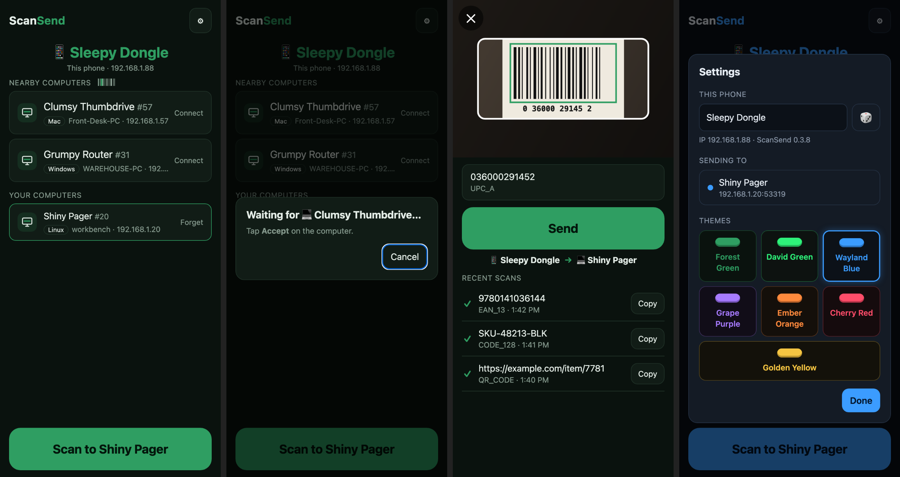
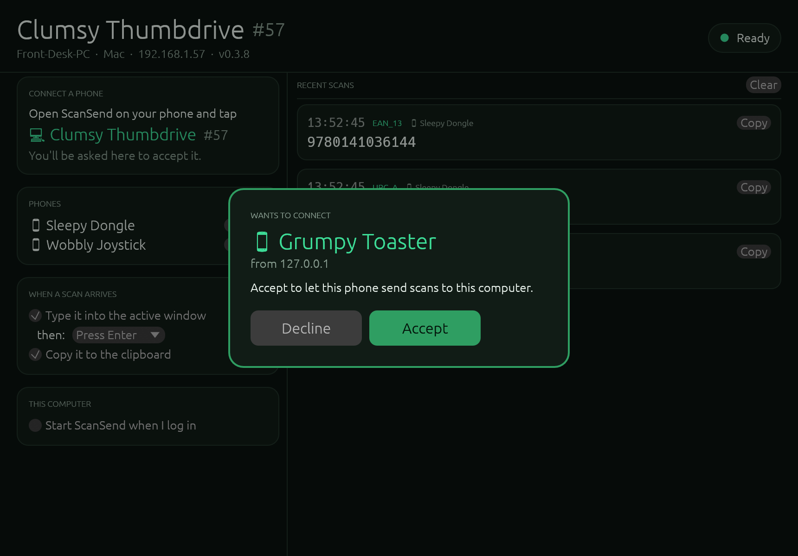
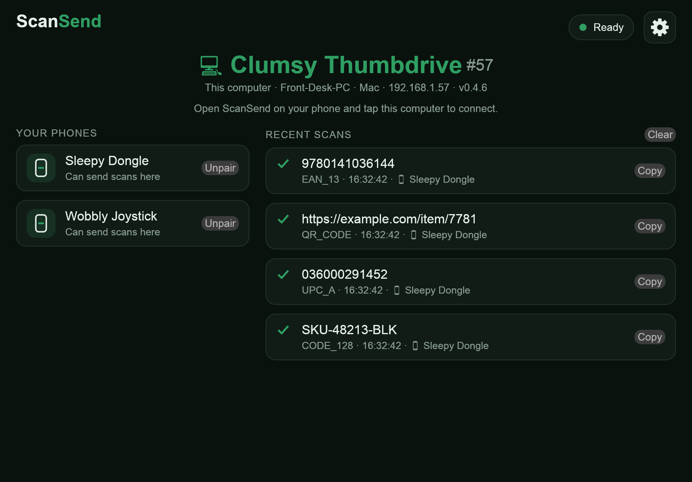
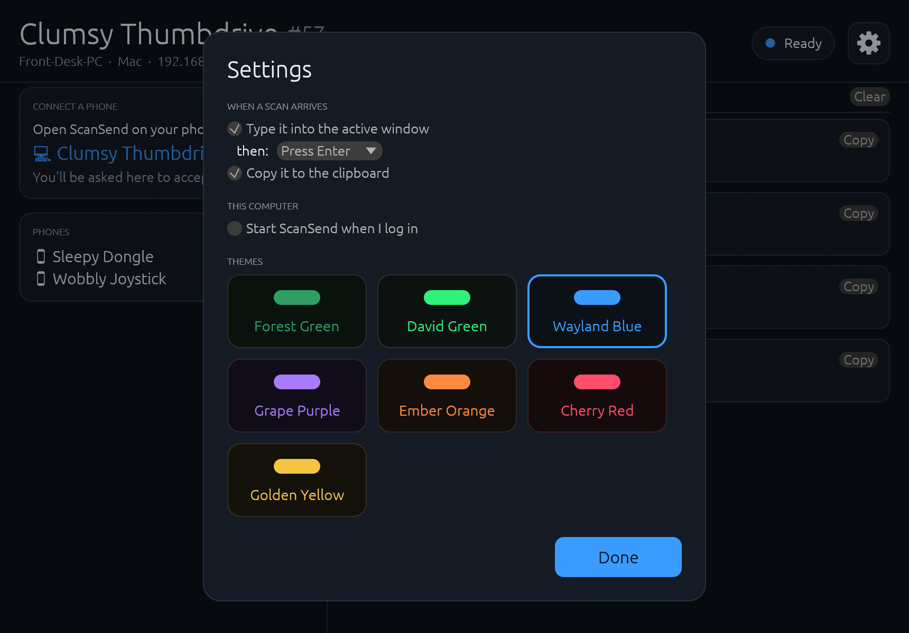

<h1 align="center">ScanSend</h1>

<p align="center">
  <b>Turn your phone into a barcode scanner for your computer.</b><br>
  Point the camera at a barcode or QR code, tap Send, and it's typed into whatever is open on your computer.<br>
  No account. No cloud. No scan limits. Your scans never leave your Wi-Fi.
</p>

<p align="center">
  <a href="../../releases/latest"><b>⬇ Download the latest version</b></a>
  <!-- DONATE: add the donation link here once it's set up, e.g.
  &nbsp;·&nbsp; <a href="https://ko-fi.com/...">♥ Support ScanSend</a> -->
</p>

<p align="center">
  
</p>

## How it works

1. **Open ScanSend on your computer.** It gets a fun name like *Clumsy Thumbdrive*.
2. **Open ScanSend on your phone.** Computers on the same Wi-Fi show up by name. Tap yours.
3. **Click Accept on the computer.** That's the whole setup, and it's remembered.
4. **Scan.** The code freezes in the box so you can check it, then **Send** types it into the
   active window (and presses Enter or Tab if you like), just like a USB barcode scanner.

<p align="center">
  
</p>

## Why ScanSend

- **Private by design.** Phone and computer talk directly over your local network. There's no
  server, no sign-up, no analytics, and it works without internet.
- **Free, with no limits.** No scan caps, no per-computer licenses, no subscriptions.
- **Connect by tapping a name.** No QR codes to scan, no IP addresses to type.
- **Reads printed text too.** Switch the camera to **Text** for serial numbers that have no
  barcode, like the ones on the back of an iPad. The likeliest serial is highlighted; tap other
  words to pick them, or fix a misread letter before sending. Read on the phone, offline.
- **See it before it's sent.** The camera freezes on the code in the box; nothing goes to the
  computer until you tap Send.
- **Works where you work.** Android and iPhone phones; Windows, Linux and Mac computers.
- **Small and to the point.** Scan, check, send. Recent scans with Copy, on both sides.
- **Make it yours.** Themes like Forest Green, Wayland Blue, Grape Purple and Ember Orange, on the phone and the computer.

<p align="center">
  
</p>

## Download

Get the latest from the **[Releases page](../../releases/latest)**:

| Device | File | Notes |
|---|---|---|
| Android phone | `ScanSend-…-android.apk` | Open it on the phone to install. Updates install over 0.4.0 and newer; uninstall a 0.3.x version once first. |
| Windows computer | `ScanSend-…-windows-setup.exe` | Installs ScanSend and allows it through Windows Firewall, so it never asks. (`…-windows-x64.exe` runs without installing.) |
| Linux computer | `ScanSend-…-linux-x64` | `chmod +x` it, then run it. |
| iPhone | — | Not on the App Store yet; build it on a Mac (below). |
| Mac computer | — | Build it from source for now (below). |

The phone and computer need to be on the **same Wi-Fi network**. ScanSend uses
**UDP 53318** (finding computers) and **TCP 53319** (scans). The Windows installer opens these
for ScanSend (local network only); on Linux, the window offers to open them for you.

## Settings on the computer

The ⚙ button opens Settings:

- **When a scan arrives:** type it into the active window, then press Enter, Tab or nothing;
  copy it to the clipboard; or both.
- **Start ScanSend when I log in.**
- **Themes:** the same seven as the phone app.

Every connected phone is listed on the main window, with **Unpair**.

<p align="center">
  
</p>

Running without a window: `scansend --terminal` (new phones are accepted by typing `y`).
Other options: `--suffix enter|tab|none`, `--no-type`, `--no-clipboard`, `--name "Front Desk"`,
`--list`, `--unpair-all`.

## Build from source

```
proto/      the shared protocol (Rust)
receiver/   the computer app (Rust, egui)
mobile/     the phone app (Tauri 2: Rust core + one HTML page)
```

**Computer:** `cargo run --release -p scansend-receiver`

**Android:** install the [Tauri 2 prerequisites](https://v2.tauri.app/start/prerequisites/), then

```sh
cd mobile && npm install
npx tauri android init
npx tauri android build --apk --debug --target aarch64
```

**iPhone** (on a Mac with Xcode and a free Apple ID):

```sh
cd mobile && npm install
APPLE_DEVELOPMENT_TEAM=<your team id> npx tauri ios build --debug
```

The Xcode project is in the repo (`mobile/src-tauri/gen/apple`), so there's no `ios init` step.
Then install it from Xcode (open `mobile/src-tauri/gen/apple/*.xcodeproj` and press ▶).
Apps installed with a free Apple ID need reinstalling every 7 days.

## How the phone finds the computer

The computer answers "who's there?" messages on UDP 53318 and serves a small HTTP API on
TCP 53319. The phone also checks each address on its Wi-Fi directly, which is what works on
iPhone: the whole subnet up to a /20 around the phone, plus the neighborhood of every computer
it's paired with, so on big networks adding one computer by address brings in the ones near it. Tapping a computer sends a connect request that waits until someone clicks Accept;
after that, every scan carries a token only that phone has. Details are in
[`proto/src/lib.rs`](proto/src/lib.rs).

## License

[MIT](LICENSE). Barcode reading on iPhone uses [ZXing](https://github.com/zxing-cpp/zxing-cpp)
via [barcode-detector](https://github.com/Sec-ant/barcode-detector) (MIT). Text reading uses
[Tesseract](https://github.com/tesseract-ocr/tesseract) via
[tesseract.js](https://github.com/naptha/tesseract.js) with its English data (Apache-2.0).
